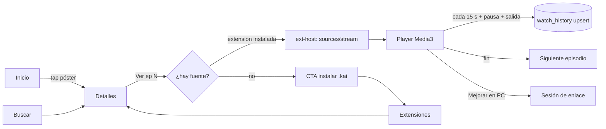
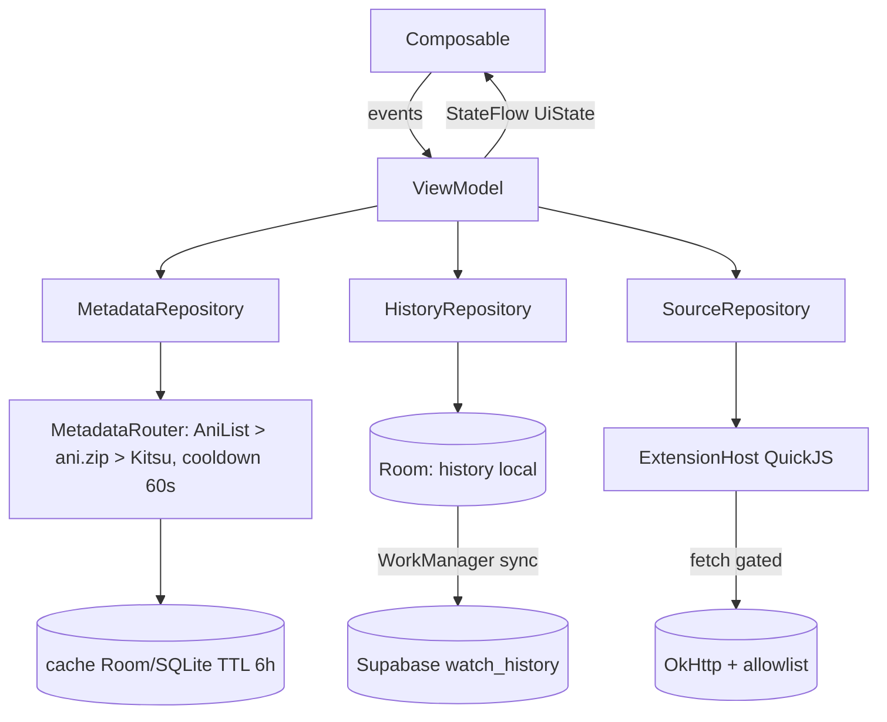
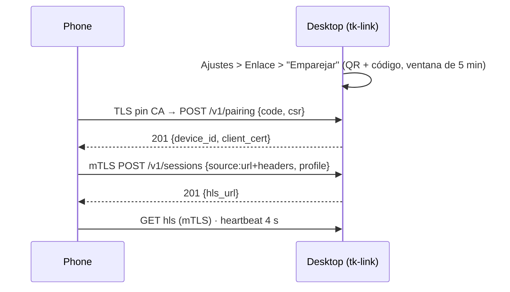

# 02 — Arquitectura de información y flujos

> Versión de trabajo con las enmiendas de `05-review.md` (E7, E10) y las decisiones de `06-user-decisions.md` ya aplicadas. M0 = solo anime; Biblioteca Android local; Link por QR/pegar código.

## 1. Principios
1. **Core loop primero**: descubrir → detalle → reproducir/leer → progreso sincronizado. Todo lo demás es secundario.
2. **Una sola fuente de verdad por pantalla** (ViewModel/StateFlow en Android; `Signal` + `use_resource` en Dioxus). Nada de 30 queries al montar.
3. **Listas siempre virtualizadas** (`LazyColumn/LazyVerticalGrid` con `key` + `contentType`; desktop: ventana virtual en `tk-ui`).
4. **Cero overlays globales** salvo: snackbar host, mini-player, indicador de dispositivo enlazado.

## 2. Navegación por forma de ventana
| Forma | Contenedor | Destinos primarios |
|---|---|---|
| Phone (compact) | `ShortNavigationBar` (4 destinos) + FloatingToolbar contextual en Detalles/Reader | Inicio · Buscar · Biblioteca · Tú |
| Foldable/tablet (medium/expanded) | `NavigationRail` + list-detail (`ListDetailPaneScaffold`) | ídem + Descargas en rail |
| Desktop | Rail expandible a drawer (Ctrl+B) + title bar propia; multipanel: lista │ detalle │ (cola/episodios) | Inicio · Buscar · Biblioteca · Descargas · Extensiones · Enlace · Ajustes |
| TV (M2) | Rail lateral con foco, filas horizontales | Inicio · Buscar · Biblioteca · Enlace · Ajustes |

"Tú" (phone) agrupa: Perfil, Historial, Descargas, Extensiones, Dispositivo enlazado, Ajustes.
Búsqueda global: `SearchBar` en Inicio (phone) / Ctrl+K (desktop). Las fuentes de extensiones aparecen como **pestañas de origen**
dentro de Buscar y como filas en Inicio, no como un dropdown en la barra.

## 3. Pantallas (spec breve)
| Pantalla | Contenido | Estados | Milestone |
|---|---|---|---|
| **Inicio** | Hero carousel (trending, 5 ítems) · Continuar viendo (desde `watch_history`) · Filas: En emisión, Temporada, Top, Manga popular, Novelas · filas de extensiones (`customHome`) cargadas **perezosamente al entrar en viewport** | skeleton por fila; error por fila con "Reintentar" (no rompe la pantalla) | M0 (anime), M1 (manga/novela) |
| **Buscar** | SearchBar con historial; chips de tipo (Anime/Manga/Novela) y de origen (Metadata/extensión X); filtros en AdaptiveSheet (género, año, temporada, formato, estado) | vacío con sugerencias; sin resultados; offline | M0 (metadata), M1 (extensiones) |
| **Detalles anime** | Header con póster (shared element) + color de póster · FloatingToolbar: Ver/Continuar, Añadir a lista, Descargar, Enviar a dispositivo · pestañas: Episodios (agrupados en rangos de 100), Info, Relacionados, Personajes · selector de fuente/proveedor | episodios sin fuente → CTA "Instalar/elegir extensión" | M0 |
| **Detalles manga/novela** | Igual con Capítulos, idioma/scanlator, "Leer siguiente" | — | M1 |
| **Player** | Media3 (M0) / mpv (M1): seek con miniaturas, saltar intro/OP (ani.zip/aniskip en M1), chips calidad/audio/subs, velocidad, PiP, bloqueo de pantalla, gestos brillo/volumen, siguiente episodio con cuenta atrás · menú **Mejora**: Anime4K local (M1 Android, M0 desktop) o "Mejorar en PC" (enlace) | buffering con `LoadingIndicator`; error de fuente → probar siguiente proveedor automáticamente (máx. 3) y mostrar cuál falló | M0 |
| **Reader** | Paginado/webtoon, pinch-zoom (paridad con upstream 6.4.2), prefetch 3 páginas, upscale de imagen (M3) | — | M1 |
| **Biblioteca** | **M0 = local**: "Continuar viendo" + Historial (Room, con sync a `watch_history` si hay sesión). **M1**: pestañas Viendo · Planeado · Completado · Pausado · Abandonado con las listas de AniList/MAL (lectura y escritura; requieren los tokens OAuth que el login email/contraseña de M0 no vincula); orden y filtros; sincronización en segundo plano | sin cuenta → la biblioteca local funciona sin login; CTA para iniciar sesión (solo sync) | M0 (local), M1 (listas AniList/MAL + escritura + sync) |
| **Extensiones** | Lista instaladas con nivel de compatibilidad (`full/partial/unsupported`), permisos de red visibles, "Instalar .kai desde archivo", activar/desactivar, logs por extensión | instalación inválida → error explicando qué campo del manifest falla | M0 |
| **Ajustes** | Apariencia (paleta, AMOLED, contraste, dinámico, **idioma: sistema / en / es**), Reproductor (motor, Anime4K preset, decodificador), Metadata (prioridad de proveedores), Cuentas (Supabase, AniList, MAL), Datos y almacenamiento, Acerca de/licencias (AGPL-3.0-or-later, OFL de las fuentes, LGPL de libmpv/FFmpeg). **Una pantalla con secciones** (no modal de 25 paneles) | — | M0 (Apariencia, Metadata, Cuenta) |
| **Perfil** | Avatar, stats, listas públicas | — | M2 |
| **Watch rooms** | Crear/unirse por código; chat + sync de reproducción (Supabase realtime) | — | M2 |
| **Traducir** | Workspace de traducción del upstream (on-device ONNX) — en desktop vía `ort`; en Android se deja en legacy | — | M3 |
| **Descargas** | Cola con wavy progress, pausar/reanudar, almacenamiento | — | M1 |
| **Dispositivo enlazado** | Estado (PC conectada, GPU, perfiles medidos), Emparejar (**escanear QR con CameraX+zxing, sin Google Play services, o pegar el código**; sin mDNS ni TOFU en M0), "Continuar en…", control remoto, olvidar/revocar | sin PC → explicación + botón "Emparejar" (el permiso de cámara se pide en contexto; "Pegar código" siempre disponible) | M0 (emparejar + transcodificar fuente `url`), M1 (descubrimiento mDNS, handoff/control, ajustes compartidos) |

### Se cortan / fusionan / difieren
- **Cortados**: DynamicIsland, popups promocionales, easter eggs, consolas de dev en UI, tracking de presencia/engagement, pull-to-refresh global, QuickPeek, splash fijo (se usa SplashScreen API hasta primer frame), marketplace/store, extensiones renderer (React), temas de extensiones.
- **Fusionados**: /trending, /recommendations, /suggestions, /genre/:g, /calendar → filas y filtros de Inicio/Buscar; /favorites, /collections, /playlists → Biblioteca (M2: colecciones); /offline-library → Descargas; Settings modal → pantalla Ajustes.
- **Diferidos**: Comunidad/foro (M3+), Tierlists, Wrapped, Stats (M3), IPTV (M3), Torrent/Debrid (M2), Admin (queda en legacy web).

## 4. Flujos de usuario

### 4.1 Core loop (anime)

### 4.2 Flujo de datos (Android)

Regla: **local-first**. El historial se escribe en Room y se sube con WorkManager (coalescido, máx. 1 req/15 s). Sin login todo funciona salvo sync.

### 4.3 Enlace PC ↔ móvil (resumen; detalle en 03)

## 5. Estados vacíos / carga / error (reglas comunes)
- **i18n**: solo `en` y `es` (Android `values/` + `values-es/`, lint `HardcodedText` como error; desktop `tk-ui/i18n/{en,es}.json` + `t("key")`, idioma del sistema con override en Ajustes). Japonés cae a inglés; nunca texto literal en componentes.
- **Carga**: skeleton con la forma final (sin spinners de pantalla completa) salvo player (`ContainedLoadingIndicator`). Mostrar skeleton solo tras 150 ms.
- **Vacío**: ilustración ligera (vector) + una frase + una acción.
- **Error**: inline por sección con causa legible (`Sin conexión`, `AniList limitó las solicitudes, usando Kitsu`, `La extensión X falló: timeout`) + Reintentar. Nunca toasts apilados.
- **Offline**: banner discreto en top bar; contenido cacheado sigue navegable.
- **Rendimiento objetivo (Android, gama media)**: arranque en frío < 1.2 s a primer frame útil, scroll a 60 fps sin jank > 5 %, apertura de Detalles < 300 ms con caché. Se mide con baseline profile + macrobenchmark en M1.
